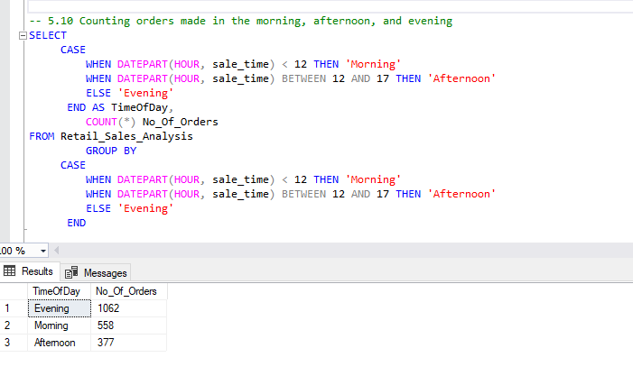
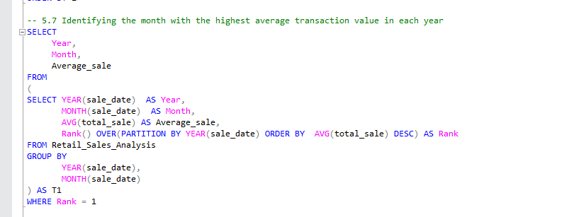

# Retail Sales Analysis (SQL)

**A SQL Server project that cleans a retail sales dataset and answers ten business questions about sales, customers, and when people shop.**

---

## Project Overview

**Brief Description**
A SQL analysis of 1,997 retail sales transactions from 2022 and 2023, covering data cleaning, data exploration, and ten business queries on revenue, product categories, customers, and time of day.

**Tools & Skills Used**
SQL Server, T-SQL, Data Cleaning, Aggregations (`SUM`, `COUNT`, `AVG`), `GROUP BY`, `CASE WHEN`, Window Functions (`RANK() OVER`), Subqueries, Date Functions.

**Project Goals**
To clean a raw sales table and use SQL to find which categories earn the most, who the best customers are, and when customers buy.

**Results**
Electronics, Clothing, and Beauty earn almost the same revenue (about 287K to 314K each), 306 transactions were worth more than 1,000, and about 53% of orders were placed in the evening.

---

## Business Questions

1. How many sales were made, and how many customers were served?
2. How much revenue did each product category earn?
3. Do men and women buy different categories?
4. Which month has the highest average transaction value in each year?
5. Who are the top five customers?
6. How many unique customers bought from each category?
7. At what time of day do customers buy?

---

## Dataset

A retail sales table with **2,000 raw records** and 11 columns, covering **1 January 2022 to 31 December 2023**.

| Column | Meaning |
|---|---|
| `transactions_id` | Unique ID of each sale |
| `sale_date`, `sale_time` | When the sale happened |
| `customer_id` | Customer who made the purchase |
| `gender`, `age` | Customer details |
| `category` | Beauty, Clothing, or Electronics |
| `quantity` | Units bought |
| `price_per_unit` | Price of one unit |
| `cogs` | Cost of goods sold |
| `total_sale` | Total value of the sale |

---

## Data Cleaning

| Problem found | What I did | Result |
|---|---|---|
| The quantity column was misspelt (`quantiy`) | Renamed it with `sp_rename` | Column is now `quantity` |
| **10** records had a missing `age` | Replaced them with the average customer age (41) | No missing ages left |
| **3** records had missing quantity, price, COGS, and total sale | Deleted them, because the sale values could not be recovered | **1,997** clean records |

After cleaning, I checked the record count and confirmed that no missing ages remained.

---

## Key Findings

| Question | Result |
|---|---|
| Total clean transactions | **1,997** |
| Unique customers | **155** |
| Total revenue | **911,720** |
| Revenue by category | Electronics **313,810** (684 orders), Clothing **311,070** (701), Beauty **286,840** (612) |
| Category and gender | Beauty is the only category where more women than men bought (330 vs 282); Clothing and Electronics are almost equal |
| Highest average transaction value | **July 2022** (541.34) and **February 2023** (535.53) |
| Large transactions | **306** sales were worth more than 1,000 |
| Top customer | Customer **3**, with total sales of **38,440**, followed by customers 1, 5, 2, and 4 |
| Customers per category | Clothing 149, Electronics 144, Beauty 141 |
| Time of day | Evening **1,062** orders (about 53%), Morning **558**, Afternoon **377** |
| Beauty customers | Average age of about **40** |

**What this means:** the three categories are almost equally important, so no single category carries the business. Most orders come in the evening, so staffing and promotions could be timed for that period. A handful of customers account for a lot of the spending, which makes them worth keeping.

---

## Example Queries

**Revenue and orders by category**
```sql
SELECT
     category,
     SUM(total_sale) AS net_sales,
     COUNT(*) AS total_order
FROM Retail_Sales_Analysis
GROUP BY category
```

**Best month by average sale in each year** (window function)
```sql
SELECT Year, Month, Average_sale
FROM
(
SELECT YEAR(sale_date) AS Year,
       MONTH(sale_date) AS Month,
       AVG(total_sale) AS Average_sale,
       RANK() OVER(PARTITION BY YEAR(sale_date) ORDER BY AVG(total_sale) DESC) AS Rank
FROM Retail_Sales_Analysis
GROUP BY YEAR(sale_date), MONTH(sale_date)
) AS T1
WHERE Rank = 1
```

**Orders by time of day**
```sql
SELECT
     CASE
         WHEN DATEPART(HOUR, sale_time) < 12 THEN 'Morning'
         WHEN DATEPART(HOUR, sale_time) BETWEEN 12 AND 17 THEN 'Afternoon'
         ELSE 'Evening'
     END AS TimeOfDay,
     COUNT(*) AS No_Of_Orders
FROM Retail_Sales_Analysis
GROUP BY
     CASE
         WHEN DATEPART(HOUR, sale_time) < 12 THEN 'Morning'
         WHEN DATEPART(HOUR, sale_time) BETWEEN 12 AND 17 THEN 'Afternoon'
         ELSE 'Evening'
     END
```

The full script, with all ten business queries, is here: [sql/retail_sales_analysis.sql](sql/retail_sales_analysis.sql)

---

## Query Results

**Revenue and orders by category**

**Orders by time of day**


**Month with the highest average sale in each year**


---

## How to Run This Project

1. Open SQL Server Management Studio (SSMS) and create a database (the script does this in section 1).
2. Import `data/retail_sales_dataset.csv` into the database, and name the table `Retail_Sales_Analysis`.
3. Open `sql/retail_sales_analysis.sql` and run it section by section: setup, data check, cleaning, exploration, then the business analysis.

---

## Limitations

- Replacing 10 missing ages with the average age is a simple method. It slightly affects age-based results, but those records are a small share of the data.
- The dataset does not state the currency, so revenue is shown without a currency symbol.
- The data shows what happened, but not why.

---

## Project Files

```
retail-sales-sql-analytics/
├── README.md
├── sql/
│   └── retail_sales_analysis.sql
├── data/
│   └── retail_sales_dataset.csv
└── results/
    ├── 01_revenue_by_category.png
    ├── 02_orders_by_time_of_day.png
    └── 03_best_month_by_average_sale.png
```
